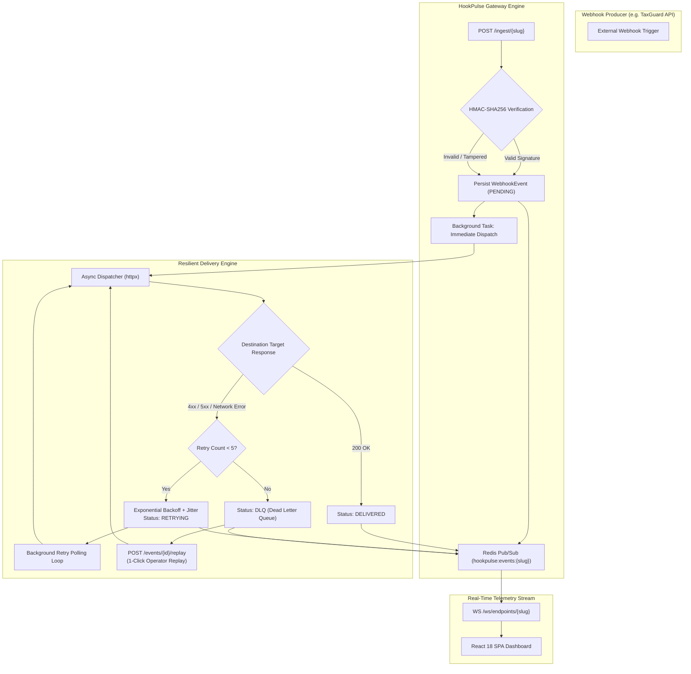

# ⚡ HookPulse

<div align="center">


**Real-time webhook gateway, live payload inspector & resilient delivery engine with exponential backoff, Dead-Letter Queue (DLQ), and interactive React SPA dashboard.**

</div>

---

## 📖 Executive Overview

**HookPulse** is a distributed webhook infrastructure engine engineered to ingest, verify, inspect, and reliably deliver high-volume webhook events. Built with an asynchronous Python 3.12 backend (FastAPI, SQLAlchemy 2.0 Async, Redis Pub/Sub) and a modern React 18 TypeScript SPA, HookPulse serves as an enterprise-grade buffer between external webhook producers (e.g., Stripe, GitHub, TaxGuard) and downstream microservices.

### Why HookPulse?
- **Sub-15ms Ingestion Guarantee:** Asynchronous non-blocking architecture returns `202 Accepted` immediately upon HMAC signature validation and database staging.
- **Timing-Attack Resistance:** Constant-time `HMAC-SHA256` cryptographic signature verification prevents secret disclosure.
- **Resilient Delivery & Full Jitter Backoff:** Dispatches webhooks with exponential backoff (`delay = 2^attempt + uniform(0.1, 1.5)s`) to eliminate downstream thundering herds.
- **Dead-Letter Queue (DLQ) & Zero-Data-Loss Recovery:** Automatically quarantines events exceeding 5 retry attempts, allowing operators to manually replay events with 1-click once target outages are resolved.
- **Real-Time Telemetry over WebSockets:** Redis Pub/Sub bridges every incoming event, delivery attempt, and status mutation directly to browser dashboards with sub-millisecond propagation.

---

## 🏗️ System Architecture



---

## ⚡ Core Technical Capabilities

### 1. Constant-Time Cryptographic Verification
Protects webhook ingestion endpoints using standard `HMAC-SHA256` hashing and timing-safe comparisons (`hmac.compare_digest`). Supports both raw hex signatures and prefixed headers (`sha256=<hex>`).

### 2. Exponential Backoff with Random Jitter
Implements decorrelated exponential backoff adhering to distributed systems best practices:
$$\text{Delay} = 2^{\text{attempt}} + \text{random}(0.1, 1.5)\text{ seconds}$$
After 5 unsuccessful delivery attempts, events are quarantined in the **Dead Letter Queue (DLQ)** without impacting ongoing ingestion traffic.

### 3. Integrated TaxGuard Traffic Simulator
Includes an embedded traffic generator simulating fiscal batch compliance webhooks (`tax_id.batch.completed`), complete with a configurable mock destination receiver (`?behavior=success|fail`) to demonstrate live retries and DLQ routing out of the box.

### 4. Interactive Live Dashboard
- **Live Event Feed:** Filter by status (`DELIVERED`, `RETRYING`, `DLQ`), search by event type, inspect timestamp and HMAC verification badges.
- **Payload & Headers Inspector:** Formatted JSON viewer with 1-click clipboard copy.
- **Delivery Attempts Timeline:** Step-by-step latency tracking (`latency_ms`), status codes, response snippets, and next retry countdowns.
- **1-Click DLQ Recovery:** Re-triggers failed webhooks instantly via `POST /api/v1/events/{id}/replay`.

---

## 🚀 Quickstart with Docker Compose

HookPulse includes a production-ready, multi-container Docker Compose configuration:

### 1. Clone the repository
```bash
git clone https://github.com/Edgar-Cbr/hookpulse.git
cd hookpulse
```

### 2. Launch the services
```bash
docker compose up --build
```

### 3. Access the interfaces
| Service | URL | Description |
| :--- | :--- | :--- |
| **Frontend Dashboard** | `http://localhost:3000` | Real-time React SPA with live event stream |
| **FastAPI Swagger Docs** | `http://localhost:8000/docs` | Interactive OpenAPI documentation |
| **Backend Health Check** | `http://localhost:8000/health` | PostgreSQL and Redis health status |
| **Ingestion Endpoint** | `http://localhost:8000/ingest/ep_taxguard_prod` | High-speed webhook ingest route |

---

## 🛠️ API & WebSocket Reference

| Method & Route | Description | Key Response |
| :--- | :--- | :--- |
| `GET /health` | Healthcheck verifying PostgreSQL & Redis | `{"status": "ok", "postgres": true, "redis": true}` |
| `GET /api/v1/endpoints` | List configured webhook endpoints and state counts | `200 OK` (Endpoint list) |
| `POST /api/v1/endpoints` | Register a new webhook tunnel & auto-generate signing secret | `201 Created` |
| `POST /ingest/{slug}` | **High-speed ingest:** validates HMAC, persists event, triggers dispatch | `202 Accepted` |
| `GET /api/v1/endpoints/{slug}/events` | Retrieve last 50 events with delivery attempt timelines | `200 OK` (Event details) |
| `POST /api/v1/events/{event_id}/replay` | **Manual Replay:** force immediate re-dispatch of DLQ or delivered events | `200 OK` (Refreshed event) |
| `POST /api/v1/simulator/trigger` | Dispatch simulated TaxGuard fiscal compliance webhook | `202 Accepted` |
| `POST /api/v1/simulator/mock-target` | Mock downstream server (`?behavior=success\|fail`) | `200 OK` or `500 Error` |
| `WS /ws/endpoints/{slug}` | Real-time WebSocket event & attempt streaming bridge | JSON updates |

---

## 🌿 Enterprise GitFlow Strategy

This project strictly adheres to professional GitFlow engineering practices:

```
main          ───────────────────────────────────────────────────● (v1.0.0 Release)
                                                                 ▲
develop       ───●──────────●──────────●──────────●──────────●───┘
                 ▲          ▲          ▲          ▲          ▲
                 │ (Phase 1)│ (Phase 2)│ (Phase 3)│ (Phase 4)│ (Phase 5)
feature branches ┴──────────┴──────────┴──────────┴──────────┴────
```

- **`main`**: Production-only branch. Strictly receives `--no-ff` merge releases from `develop`.
- **`develop`**: Integration branch where all completed feature phases are merged.
- **Granular Micro-Commits**: Every phase was divided into 4 to 6 atomic, semantic Conventional Commits pushed continuously to GitHub in real time.

---

## 🧪 Running Automated Tests

```bash
cd backend
pytest tests/ -v
```

The test suite validates:
- Constant-time HMAC-SHA256 signature computation and tamper rejection.
- Strict exponential growth and jitter bounds for backoff delays.
- State machine transitions from `RETRYING` to `DLQ` after 5 attempts.
- TaxGuard compliant payload generation.

---

## 📄 License

This project is licensed under the MIT License - see the [LICENSE](LICENSE) file for details.
